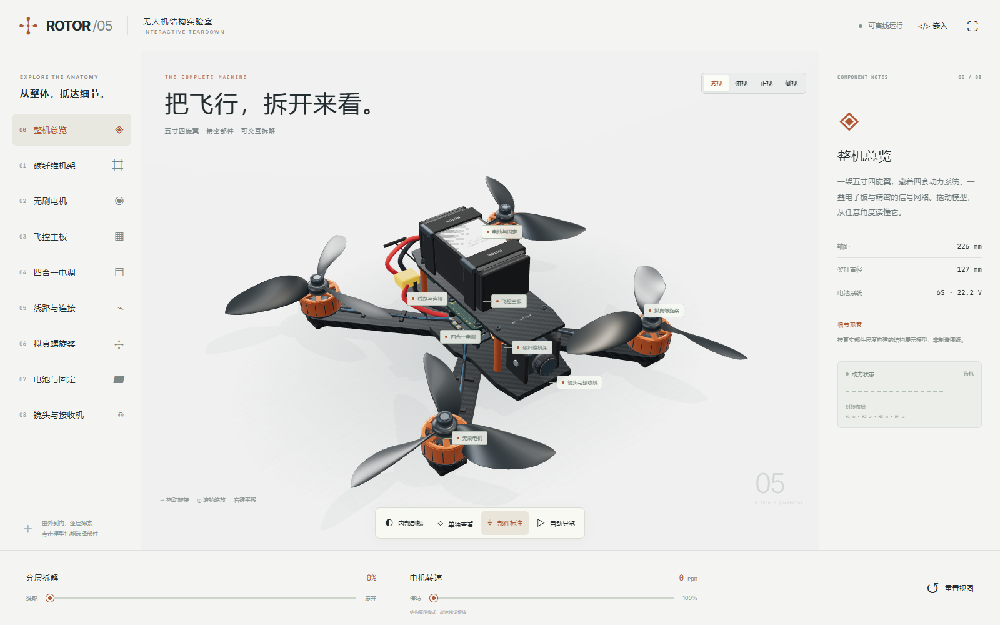

# ROTOR / 05 · 无人机结构实验室

精细五寸四旋翼无人机的纯前端互动网页，可离线打开，也可通过 iframe 嵌入其他网站。无需后端、数据库或 CDN。



## 打开与嵌入

下载仓库后，用 Chrome 或 Edge 打开 `无人机结构实验室.html`。`无人机嵌入示例.html` 演示独立页面的嵌入与外部按钮控制。右上角「嵌入」可复制代码。

```html
<iframe
  src="./无人机结构实验室.html?embed=1"
  title="无人机结构实验室"
  style="width:100%;height:760px;border:0;border-radius:16px"
  allow="fullscreen"
  loading="lazy"
></iframe>
```

## 精细结构与交互

- 四套 2207 外转子电机：铜线圈、定子齿、14 块磁钢、空心钟罩与桨轴。
- 飞控主板：主控芯片、引脚、贴片元件、走线、微过孔、USB-C 与 JST 插座。
- 四合一电调：24 颗 MOSFET、三相相线、焊点与低 ESR 电容。
- 拟真扭转翼型螺旋桨、碳纤维机架、LiPo 电池、XT60 接头、镜头与接收机。
- 自由旋转、缩放、部件特写、分层拆解、内部剖视、自动导览与可调转速。
- 手机布局与父页面 `postMessage` 控制。

## 文件

| 文件或目录 | 用途 |
| --- | --- |
| `无人机结构实验室.html` | 自包含主网页 |
| `无人机嵌入示例.html` | iframe 嵌入与外部按钮示例 |
| `无人机纯前端网页.zip` | 主网页、示例和使用说明打包 |
| `ROTOR05_精细无人机.glb` | 可导入 Blender 的精细模型，单位米 |
| `drone/` | JavaScript、CSS 源码、构建与验证脚本 |
| `drone/使用说明.md` | 操作、参数、前端接口和结构说明 |
| `preview/` | 实际渲染截图、导览联系表与验证记录 |
| `PROJECT_RECORD.md` | 需求与项目记录 |

## 验证

浏览器交互、真实 iframe 的外部按钮联动、390–1200 px 布局与 GLB 导出均已检查。验证过程未发生外部网络请求，无浏览器脚本错误。十二片桨叶均为闭合实体，顶点数值检查通过。详见 `preview/final-validation.json`。

模型用于结构展示。飞控布局和电路走线为视觉示意，不作为生产 PCB 或制造 CAD。

本机源码重建依赖 teardown 技能已有的本地 Node.js 工具链；已构建的 HTML 不需要安装任何依赖。teardown 运行框架与 Three.js 使用 MIT 许可。
